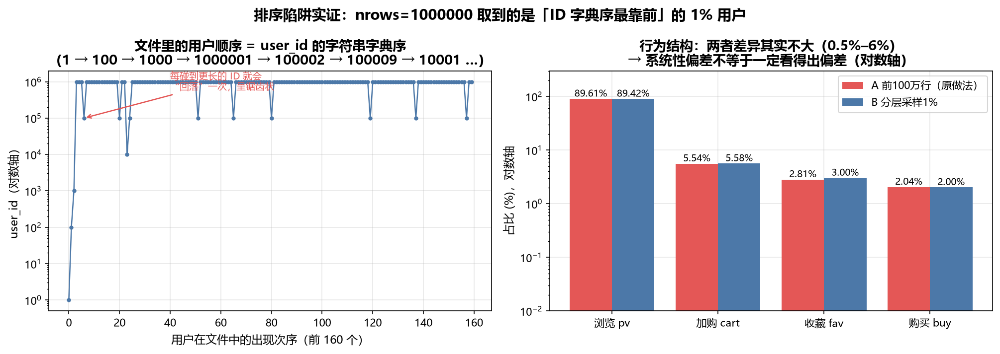

# 数据质量报告 · 淘宝 UserBehavior

> 数据源：`C:\Users\zhao\Desktop\数据分析\UserBehavior.csv`（3.42 GB）
> 统计口径：全量 100,150,807 行，时间戳按 **北京时间（UTC+8）** 解释
> 生成时间：2026-11-16 01:00

---

## 一、读取方式选型（1.1）

| 方法 | 处理行数 | 耗时(秒) | 吞吐(万行/秒) | 峰值内存(GB) | 备注 |
|---|---|---|---|---|---|
| pandas chunksize | 5,000,000 | 7.918 | 63.14 | 0.1963 | 内存型，全量需 ~30 GB |
| pyarrow 流式 | 5,482,051 | 16.63 | 32.96 | - | 零拷贝，适合列式管道 |
| duckdb 全量扫描+聚合 | 100,150,807 | 10.25 | 977.3 | - | 零部署，直接对 CSV 跑 SQL |

**结论**：pandas 全量读入需要约 30 GB 内存（1 亿行 × 5 列），单机不可行；pyarrow 流式可用但需要自己写聚合逻辑。
本项目主链路选择 **DuckDB 直接对 CSV 跑 SQL**：零部署、列式向量化、多线程，全量 `count(*)` 仅为
10.2 秒，后续所有聚合都走它。
pandas 只保留 10% 分层样本用于交互式探索。

## 二、基础指标（1.2）

| 指标 | 值 |
|---|---|
| 总行数 | 100,150,807 |
| 唯一用户数 | 987,994 |
| 唯一商品数 | 4,162,024 |
| 唯一类目数 | 9,439 |
| 全量时间范围 | 1902-05-08 06:32:46 ~ 2037-04-09 13:22:35（共 347 个不同日期） |
| **有效窗口内** | **2017-11-25 00:00:00 ~ 2017-12-03 23:59:59（9 天，100,095,231 行）** |
| 窗口外行数 | 55,576（占比 0.055%） |

逐日明细（有效窗口内）：

| 日期 | 行数 | 活跃用户数 |
|---|---|---|
| 2017-11-25 | 10,420,015 | 706,641 |
| 2017-11-26 | 10,664,602 | 715,516 |
| 2017-11-27 | 10,101,147 | 710,094 |
| 2017-11-28 | 9,878,190 | 709,257 |
| 2017-11-29 | 10,284,073 | 718,922 |
| 2017-11-30 | 10,447,740 | 730,597 |
| 2017-12-01 | 10,859,436 | 740,139 |
| 2017-12-02 | 13,777,869 | 970,401 |
| 2017-12-03 | 13,662,159 | 966,977 |

行为类型构成：

| 行为 | 行为数 | 去重用户数 | 去重商品数 | 行为数占比 |
|---|---|---|---|---|
| pv(浏览) | 89,716,264 | 984,114 | 4,068,790 | 0.8958 |
| cart(加购) | 5,530,446 | 738,996 | 1,228,889 | 0.05522 |
| fav(收藏) | 2,888,258 | 389,823 | 880,594 | 0.02884 |
| buy(购买) | 2,015,839 | 672,404 | 638,962 | 0.02013 |

## 三、质量检查（1.3）

| 检查项 | 说明 | 结果 | 判定 |
|---|---|---|---|
| 缺失值 | user_id 为空的行数 | 0 | 0 为正常 |
| 缺失值 | item_id 为空的行数 | 0 | 0 为正常 |
| 缺失值 | category_id 为空的行数 | 0 | 0 为正常 |
| 缺失值 | behavior_type 为空的行数 | 0 | 0 为正常 |
| 缺失值 | timestamp 为空的行数 | 0 | 0 为正常 |
| 重复行 | 完全重复行数（10% 样本估计） | 3 | 需在清洗时去重 |
| timestamp | 越界时间戳（早于 2017-11-25 或晚于 2017-12-03） | 55,576 | 需在中间层剔除，见 1.3' |
| 非法取值 | user_id <= 0 的行数 | 0 | 0 为正常 |
| 非法取值 | item_id <= 0 的行数 | 0 | 0 为正常 |
| 非法取值 | category_id <= 0 的行数 | 0 | 0 为正常 |
| 取值集合 | behavior_type 全部取值 | 4 | buy、cart、fav、pv |
| 异常行为 | 单用户单日 pv 分布（p50 / p99 / p99.9 / max） | 7 / 81 / 140 / 492 | 无极端刷量（max 未超 500） |
| 异常行为 | 单用户单日 pv > 140（p99.9 与 100 取大）的用户-日数 | 6,593 | 占全部用户-日 0.0975% |

### 1.3' 窗口外时间戳明细（本次探查发现的第二类真实质量问题）

全量数据里存在 **347 个不同日期**，但其中 99.94% 的行为集中在 9 天。
按窗口划分：

| 类型 | 行数 | 占比 | 性质 |
|---|---|---|---|
| 早于 2017-11-25 | 53,148 | 0.053% | 其中 9 天窗口前一天（2017-11-24）有 40,231 行，属正式采集前的爬坡；其余为明显异常 |
| 晚于 2017-12-03 | 2,428 | 0.002% | 时间戳最早到 1902 年、最晚到 2037 年，属脏数据 |

异常最集中的日期：

| 类型 | 日期 | 行数 | 涉及用户数 |
|---|---|---|---|
| 早于窗口起始 | 2017-11-24 00:00:00 | 40,231 | 33,616 |
| 早于窗口起始 | 2017-11-23 00:00:00 | 4,664 | 3,714 |
| 早于窗口起始 | 2017-11-22 00:00:00 | 1,546 | 1,276 |
| 晚于窗口结束 | 2017-12-04 00:00:00 | 825 | 158 |
| 早于窗口起始 | 2017-11-21 00:00:00 | 743 | 569 |
| 早于窗口起始 | 2017-11-19 00:00:00 | 647 | 459 |
| 早于窗口起始 | 2017-11-20 00:00:00 | 630 | 410 |
| 早于窗口起始 | 2017-11-03 00:00:00 | 562 | 55 |
| 早于窗口起始 | 2017-11-02 00:00:00 | 444 | 51 |
| 早于窗口起始 | 2017-11-18 00:00:00 | 376 | 240 |
| 早于窗口起始 | 2017-10-02 00:00:00 | 341 | 5 |
| 早于窗口起始 | 2017-11-17 00:00:00 | 205 | 135 |

**处理策略**：把分析窗口显式定义为 **2017-11-25 00:00:00 ~ 2017-12-03 23:59:59（北京时间）**，
窗口外的 55,576 行（0.055%）**在中间层剔除**，
但不修改原始 CSV；剔除规则写在 `src/config.py` 的 `WINDOW_SQL` 里，一行可见。
之所以必须剔除：若保留，仅按 `date` 分组就会凭空多出 300+ 个"日期"，DAU 趋势与留存曲线全部失真。

## 四、分布特征（1.4）

**用户活跃度**：

| 活跃度 | 用户数 | 行为数 | 用户占比 | 行为占比 |
|---|---|---|---|---|
| 1 | 85 | 85 | 8.603e-05 | 8.487e-07 |
| 2-5 | 3,556 | 15,492 | 0.003599 | 0.0001547 |
| 6-20 | 89,787 | 1,268,882 | 0.09088 | 0.01267 |
| 21-100 | 524,120 | 29,226,298 | 0.5305 | 0.2918 |
| 101-500 | 367,564 | 68,011,990 | 0.372 | 0.6791 |
| >500 | 2,882 | 1,628,060 | 0.002917 | 0.01626 |

**长尾与集中度**：人均行为 101.4 条、中位数 75 条、
最大值 848.0 条；行为量分布极度右偏。
购买侧：top 1% 用户贡献了 **6.5%** 的购买行为，
top 10% 贡献 **31.1%**，top 20% 贡献 **47.9%**。
→ 典型的"少数用户贡献多数价值"，这是 RFM 分层与运营策略的直接依据。

## 五、排序陷阱实证（1.5）——本项目最关键的一次自检

原代码用 `pd.read_csv(..., nrows=1_000_000)` 取前 100 万行。
**本次探查对这个"约定俗成"的做法做了实证检验，结论与最初的假设不一样，值得完整记录。**

### 发现一：文件不是按 user_id 数值序排的，而是按**字符串字典序**排的

实测前 300 万行中用户出现顺序为：

```
1 → 100 → 1000 → 1000001 → 1000004 → 1000011 → 100002 → 1000027 → 1000028 →
1000037 → 100009 → 10001 → 100010 → ...
```

这是典型的字典序（`"1000011" < "100002"` 因为第 6 位 `1 < 2`），而不是数值序
（数值序下 100002 应排在 1000001 之前）。换句话说，文件是按 `str(user_id)` 排序的。

**后果**：`nrows=1000000` 取到的是"ID 的十进制写法字典序最靠前"的一批用户
（形如 1、10x、100x、1000x、10000x、100000x…），这是一个**系统性、非随机**的子集，
只覆盖全站 **1%** 的用户，与"随机抽 1% 用户"完全等价不了。

### 发现二：但在这份数据上，它与分层随机抽样的**行为结构差异并不大**

| 指标 | A 前100万行(原做法) | B 分层采样1% |
|---|---|---|
| 行数 | 1,000,000 | 994,422 |
| 唯一用户数 | 9,739 | 9,847 |
| user_id 最小值 | 1 | 224 |
| user_id 最大值 | 1,018,011 | 1,017,869 |
| 覆盖天数（窗口内） | 9 | 9 |
| 起始日期 | 2017-11-25 | 2017-11-25 |
| 结束日期 | 2017-12-03 | 2017-12-03 |
| 窗口外脏时间戳行数 | 470 | 495 |
| 人均行为数 | 102.7 | 101 |
| 购买用户数 | 6,689 | 6,686 |
| 购买行为占比 | 0.02036 | 0.02003 |
| 浏览行为占比 | 0.8961 | 0.8942 |
| 加购行为占比 | 0.05545 | 0.05579 |
| 收藏行为占比 | 0.02809 | 0.03 |
| 覆盖商品数 | 399,114 | 401,609 |
| 覆盖类目数 | 5,796 | 5,827 |
| 购买用户渗透率（购买UV/浏览UV） | 0.6892 | 0.6819 |
| 最大类目浏览占比 | 0.05333 | 0.04965 |

| 对比项 | A 前100万行（原做法） | B 分层采样1% | 差异 |
|---|---|---|---|
| 唯一用户数 | 9,739 | 9,847 | 同为约 100 万行，A 覆盖用户数 -1.1% |
| user_id 区间 | 1 ~ 1,018,011 | 224 ~ 1,017,869 | A 是字典序最前的 ID，**不是数值最小** |
| 覆盖商品数 | 399,114 | 401,609 | -0.6% |
| 覆盖类目数 | 5,796 | 5,827 | -0.5% |
| 浏览行为占比 | 89.61% | 89.42% | +0.2% |
| 加购行为占比 | 5.54% | 5.58% | -0.6% |
| 收藏行为占比 | 2.81% | 3.00% | -6.4% |
| 购买行为占比 | 2.04% | 2.00% | +1.6% |
| 购买用户渗透率 | 68.92% | 68.19% | +1.1% |
| 最大类目浏览占比 | 5.33% | 4.96% | +7.4% |
| 覆盖天数 | 9 天 | 9 天 | 9 天窗口都被覆盖到 |



### 结论：为什么仍然不能用 `nrows`

1. **系统性 ≠ 无偏。** A 是一个按 ID 字符串形态筛选出来的子集，与随机抽样没有任何概率保证。
   这份数据上碰巧差异不大（各项在 0.5%–6% 量级），**换一份数据、换一个指标就可能完全不同**；
   用"碰巧没偏"来做分析，本质上是在赌。
2. **样本层级不够。** 只有 1% 的用户、1% 的行为，任何用户级结论（RFM 分层、留存 cohort、
   聚类）都会极不稳定；本项目的用户级结论都需要接近全量的样本。
3. **无法自我校验。** 不跑对照实验，根本无法知道偏没偏——本次对照实验就是花 2 分钟换来的确定性。

**修正做法**：交互式探索改用**按 user_id 哈希的分层 10% 样本**
（`hash(user_id) % 10 = 0`，同一用户的整条行为链同进同出，不把用户切碎导致漏斗虚高）；
所有对外结论一律用 **DuckDB 跑全量 1 亿行**。

## 六、已知局限

1. **时间窗口只有 9 天**：无法观察跨月/跨季度的周期性，留存分析只能做短期（次日/7 日）。
2. **无金额字段**：RFM 的 M 只能用"购买的不同商品件数"作为**代理指标**，无法衡量真实 GMV 贡献。
3. **无用户画像**：没有性别、年龄、地域，无法做人群细分，也无法排除"同一人多账号"。
4. **行为是站内日志**：只记录曝光后的点击行为，没有曝光量，因此算不出真实 CTR，"浏览"只能当近似分母。
5. **存在少量异常流量与脏时间戳**：疑似爬虫用户已标记并做敏感性对比（见阶段 2）；
   窗口外 55,576 行（0.055%）已在中间层剔除，原始文件未改动。
