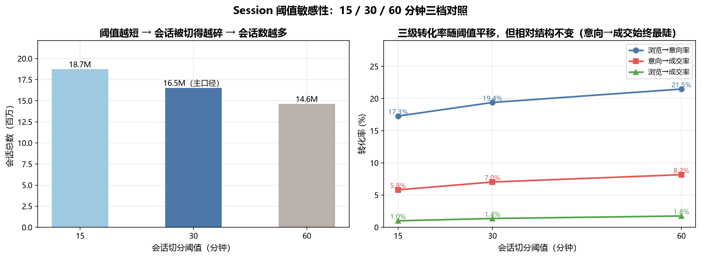

# 阶段 11 · Session 阈值敏感性分析结论

## 方法

对 15 / 30 / 60 分钟三档会话切分阈值，用**完全相同的漏斗逻辑**（同会话内 +
浏览 → 加购/收藏 → 购买顺序约束）重算 Session 口径漏斗，唯一变量是阈值本身。

| 阈值(分钟) | 会话总数 | 浏览会话 | 意向会话 | 成交会话 | 直接购买会话 | 浏览→意向率 | 意向→成交率 | 浏览→成交率 |
|---|---|---|---|---|---|---|---|---|
| 15 | 18,745,917 | 17,559,188 | 3,034,138 | 176,387 | 615,474 | 17.28% | 5.81% | 1.00% |
| 30 | 16,535,897 | 15,579,995 | 3,020,851 | 212,534 | 632,684 | 19.39% | 7.04% | 1.36% |
| 60 | 14,639,746 | 13,861,040 | 2,976,805 | 243,140 | 629,415 | 21.48% | 8.17% | 1.75% |

## 结论

1. **绝对值随阈值单调平移，方向可解释**：
   - 会话总数：15 分钟 18.7M → 30 分钟 16.5M
     → 60 分钟 14.6M。阈值越短，同一段连续浏览被切成更多会话。
   - 浏览→成交率：15 分钟 1.00% → 30 分钟 1.36%
     → 60 分钟 1.75%。阈值越长，"浏览与成交落在同一会话"的概率越大，
     转化率被机械性抬高。
2. **结论方向在三档阈值下完全一致**：无论哪一档，
   「意向→成交」都是转化率最低的一段（最陡），「浏览→意向」都是流失人数最多的一段。
   **30 分钟阈值影响的是数字大小，不影响任何一条业务建议的方向** —— 口径稳健。
3. 汇报口径维持 30 分钟（业界通用经验值），但此后被追问时可以给出三档对照表，
   说明选择是"经验值 + 已验证稳健"，而不是"拍脑袋"。
