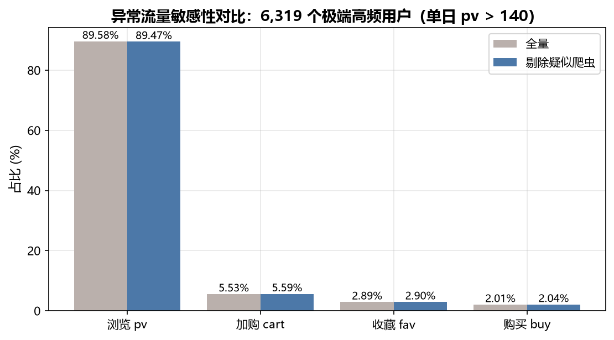

# 阶段 2 · 清洗与特征工程结论

## 一条命令复现
```bash
.venv\Scripts\python.exe src\stage2_cleaning.py
```

## 1. 时间派生（2.1）
在 DuckDB 视图 `clean` 中一次派生：`datetime / date / hour / weekday / is_weekend`。
- 时间戳按 **北京时间（UTC+8）** 解释；
- `weekday` 采用 **0 = 周一 … 6 = 周日**，与 pandas `dt.weekday` 完全一致，避免两套口径打架。

## 2. 极端高频用户标记与敏感性（2.2）

**阈值是数据驱动的，不是拍脑袋定的。**
最初的设想是用固定值（单用户单日 pv > 500），但实测发现本数据里**最大单用户单日 pv 不足 500**——
固定阈值会命中 0 个用户，清洗动作形同虚设。
因此改为：**阈值 = max(100, 用户-日 pv 的 p99.9) = 140**。

- 命中用户：**6,319**（占全部用户 0.640%）
- 命中用户最高单日 pv：**492**

处理策略：**标记而不删除**。全量口径与剔除口径同时计算，验证结论方向是否被这批流量带偏。

| 指标 | 剔除前(全量) | 剔除疑似爬虫后 | 相对变化 |
|---|---|---|---|
| 行为行数 | 100,095,231 | 97,583,732 | -2.51% |
| 用户数 | 987,991 | 981,672 | -0.64% |
| 人均行为数 | 101.3 | 99.41 | -1.88% |
| pv占比 | 0.8958 | 0.8947 | -0.12% |
| cart占比 | 0.05525 | 0.05586 | +1.09% |
| fav占比 | 0.02886 | 0.029 | +0.51% |
| buy占比 | 0.02014 | 0.02043 | +1.47% |
| 购买用户占比 | 0.6806 | 0.6799 | -0.10% |



**结论**：异常流量对行为结构的影响在 1.47% 量级以内，
方向未被改变。因此**对外结论保留全量口径**（更保守、不丢数据），并把剔除口径作为稳健性检验写在报告里。

## 3. Session 切分口径（2.3）
规则：同一用户按时间排序，**相邻行为间隔 > 30 分钟**即切分为新会话。
- 为什么是 30 分钟：业界通用的"会话超时"经验值（Google Analytics 默认 30 min）。
  用户在 30 分钟内无操作，通常意味着注意力已离开当前浏览任务；小于 15 分钟会把一次连续浏览切碎，大于 60 分钟会把两次独立访问粘在一起。
- 数据集粒度是**秒级行为流**，没有页面级停留时长，所以只能用行为间隔做代理。
- 该口径是本项目漏斗分析的基础（见阶段 4 的 session 口径漏斗）。

## 4. 分层采样（2.4）
交互式探索使用 **按 user_id 哈希的 10% 分层样本**（`hash(user_id) % 10 = 0`）：
同一用户的整条行为链同进同出，不会把用户"切碎"导致漏斗虚高。
对外结论一律用**全量**。

## 5. 中间层落地（2.5）

| 产物 | 内容 | 分区 |
|---|---|---|
| `outputs/parquet/events/` | 清洗后的全量事件 | 按 `date` |
| `outputs/parquet/daily_behavior/` | 日 × 行为类型：行为数 / 用户数 / 商品数 | 按 `date` |
| `outputs/parquet/category_daily/` | 日 × 类目：行为数 + UV 口径 | 按 `date` |
| `outputs/parquet/suspect_users.parquet` | 疑似爬虫用户清单 | — |
| `outputs/parquet/user_features.parquet` | 用户级特征宽表（pv/cart/fav/buy、活跃天数、购买天数、购买商品数、首末活跃日） | — |

效果：后续所有分析从"每次重扫 3.6 GB CSV"变成"扫 parquet"，单次全量聚合从数十秒降到数秒级。
