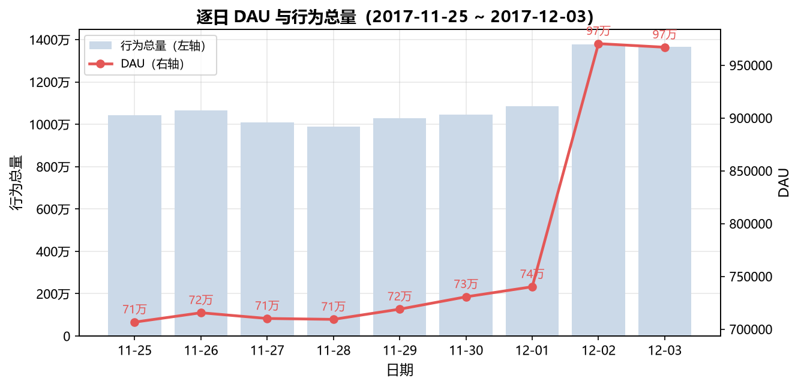
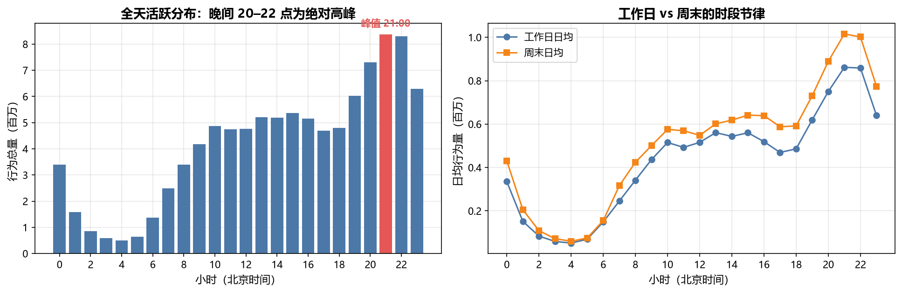
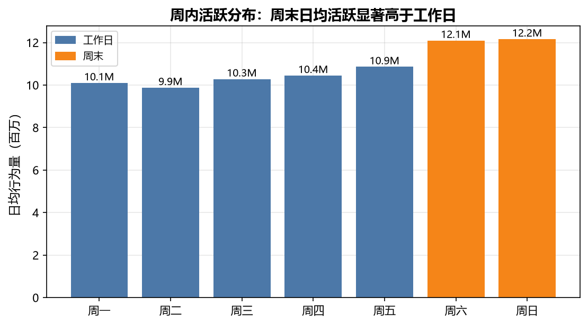
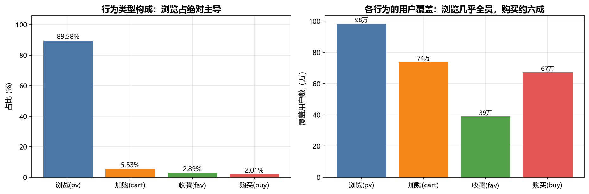
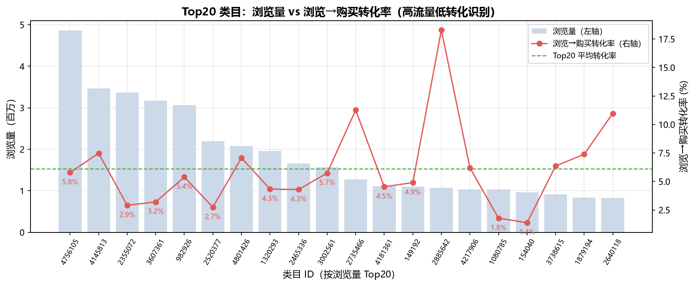
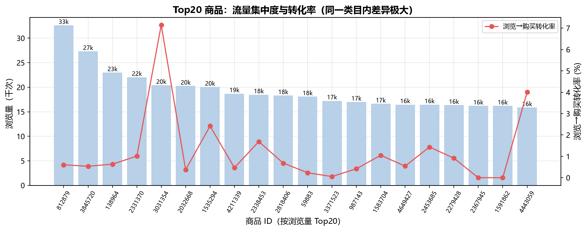
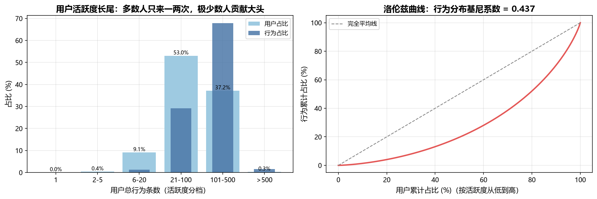

# 阶段 3 · 描述性分析结论

## 3.1 逐日 DAU
        日期    dau   events      人均行为
2017-11-25 706641 10420015 14.745840
2017-11-26 715516 10664602 14.904771
2017-11-27 710094 10101147 14.225084
2017-11-28 709257  9878190 13.927519
2017-11-29 718922 10284073 14.304852
2017-11-30 730597 10447740 14.300278
2017-12-01 740139 10859436 14.672158
2017-12-02 970401 13777869 14.198119
2017-12-03 966977 13662159 14.128732

- DAU 峰值出现在 **2017-12-02**（970,401 人），
  谷值 **2017-11-25**（706,641 人）。
- 9 天窗口内 DAU 波动幅度约 34.1%，整体处于同一量级，没有断崖式异常。

## 3.2 小时活跃分布
- 峰值时段：**21:00**；晚间 20:00–22:00 贡献全天 **24.0%** 的行为量。
- 凌晨 2:00–5:00 为最低谷（占比不足 2%）。

**可执行含义**：秒杀/直播/推送等资源投放应集中在 19:30–22:30，
凌晨做系统维护或数据批量任务对业务影响最小。

## 3.3 周内分布
名称       日均行为  users
周一 10101147.0 710094
周二  9878190.0 709257
周三 10284073.0 718922
周四 10447740.0 730597
周五 10859436.0 740139
周六 12098942.0 980636
周日 12163380.5 979334

周末日均行为量显著高于工作日（约 +17.6%），符合"周末用户有更完整的休闲时间、集中浏览与下单"的电商行为特征。

## 3.4 行为类型构成
     行为名      行为数     行为占比  覆盖用户数
  浏览(pv) 89660688 0.895754 984105
加购(cart)  5530446 0.055252 738996
 收藏(fav)  2888258 0.028855 389823
 购买(buy)  2015839 0.020139 672404

- 浏览（pv）占全部行为的 **89.58%**，是绝对主导；
- 购买行为覆盖用户的 **68.3%** —— 也就是说约六成用户在这 9 天里至少买过一次。

## 3.5 高流量 ≠ 高转化（重点）
Top20 类目中，浏览→购买转化率（UV 口径）：

- 平均转化率：**6.10%**，
  最高 **18.28%**（类目 2885642），
  最低 **1.39%**（类目 154040），**相差 13.2 倍**。
- **高流量低转化**类目（流量在 Top20 内、但转化率低于 Top20 平均）共 12 个：

      k      pv  pv_uv  buy_uv  浏览→购买转化率   加购或收藏率
 154040  960248 150102    2079  0.013851 0.186153
1080785 1035338 226441    4027  0.017784 0.209308
2520377 2192826 297244    8141  0.027388 0.278058
2355072 3373265 361785   10523  0.029086 0.290686
3607361 3169516 331737   10623  0.032022 0.273126
2465336 1657310 262536   11263  0.042901 0.292634
1320293 1959293 343972   14903  0.043326 0.274708
4181361 1109707 166701    7556  0.045327 0.328468

**可执行含义**：对"高流量低转化"类目做**详情页 / 价格 / 库存**三项诊断，
把转化率拉到该类目所在品类的均值，即可在不增加流量的前提下提升成交。

## 3.6 用户活跃度长尾
    活跃度    用户数     用户占比         行为占比
      1     88 0.000089 8.791628e-07
    2-5   3648 0.003692 1.584191e-04
   6-20  90001 0.091095 1.270167e-02
 21-100 524071 0.530441 2.919298e-01
101-500 367308 0.371773 6.789818e-01
   >500   2875 0.002910 1.622746e-02

- 仅产生 1–5 条行为的用户占 **0.4%**，
  但只贡献 **0.0%** 的行为量；
- 行为量基尼系数 **0.437**，分布高度右偏。

**可执行含义**：运营资源不应对全量用户平摊。低活跃长尾适合低成本自动化触达（Push / 券），
高活跃头部用户才值得人工运营（专属客服 / 会员权益）——这正是阶段 5 RFM 分层的落脚点。
