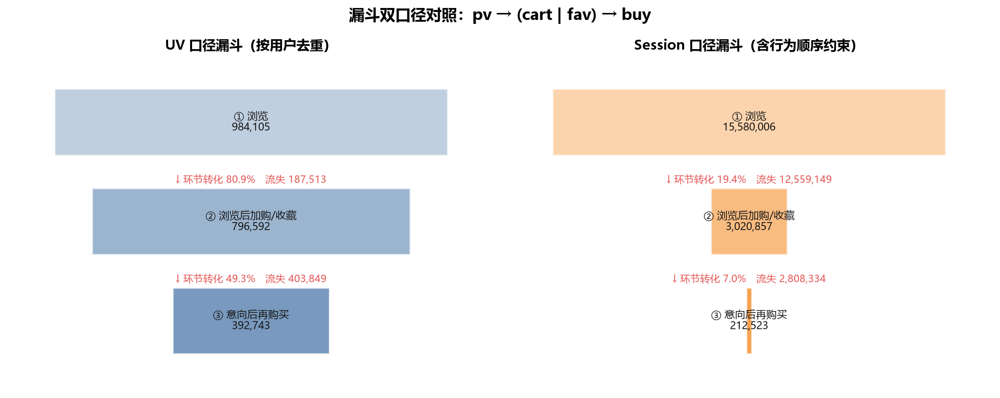
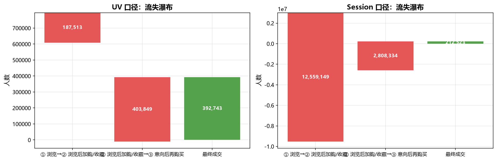
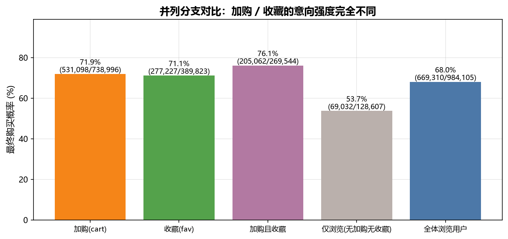
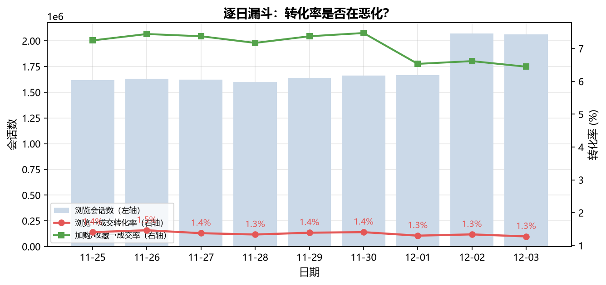
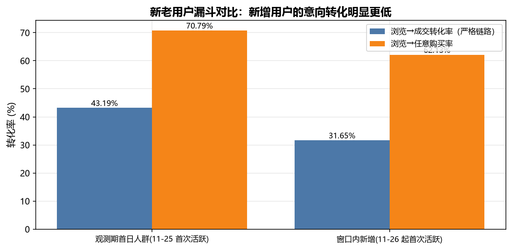
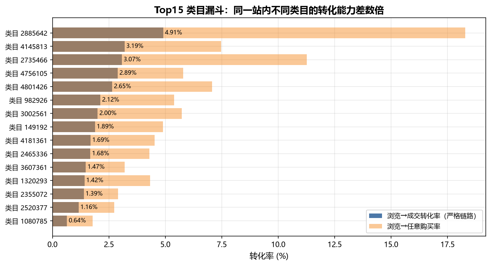

# 阶段 4 · 漏斗分析结论

## 4.1 漏斗结构修正（为什么必须改）

原代码：`step = ['pv','cart','fav','buy']`，把加购与收藏串成一条四级链路。
**这是错的**：加购（cart）与收藏（fav）是**并列的两种意向表达**，用户可能是"浏览 → 加购 → 购买"，
也可能是"浏览 → 收藏 → 购买"，不存在"必须先加购再收藏"。把它们串起来会导致中间环节人为缩窄，
所有下游转化率被系统性低估。

本项目改为：**① 浏览 → ② 浏览后加购或收藏 → ③ 意向后再购买**，
并把加购 / 收藏拆成并列分支单独用条件概率刻画（见 4.1 分支表）。

## 4.2 双口径漏斗

### UV 口径（按用户去重，9 天窗口）

| 环节 | UV 口径 | 整体转化率(相对①) | 环节转化率(相对上一步) | 流失人数 | 环节流失率 |
|---|---|---|---|---|---|
| ① 浏览 | 984,105 | 1 | 1 | 0 | 0 |
| ② 浏览后加购/收藏 | 796,592 | 0.8095 | 0.8095 | 187,513 | 0.1905 |
| ③ 意向后再购买 | 392,743 | 0.3991 | 0.493 | 403,849 | 0.507 |

### Session 口径（按 30 分钟会话切分，含行为顺序约束）

| 环节 | Session 口径 | 整体转化率(相对①) | 环节转化率(相对上一步) | 流失人数 | 环节流失率 |
|---|---|---|---|---|---|
| ① 浏览 | 15,580,006 | 1 | 1 | 0 | 0 |
| ② 浏览后加购/收藏 | 3,020,857 | 0.1939 | 0.1939 | 12,559,149 | 0.8061 |
| ③ 意向后再购买 | 212,523 | 0.01364 | 0.07035 | 2,808,334 | 0.9296 |

- 会话总数（全量）：**16,535,895**
- 严格链路（浏览→加购/收藏→购买，且顺序正确）的会话数：**212,523**
- 绕过中间环节的**直接购买**会话数：**632,666**

**两种口径的差异说明了什么**：
UV 口径把用户 9 天内的所有行为压成一次"转化判断"，会把"上周加购、这周购买"这类跨会话行为算进同一条链，
转化率天然偏高（浏览→成交 39.91%）；
Session 口径要求意向与成交发生在同一次 30 分钟会话内，口径更严，转化率更低（1.36%），
但它更接近"这一次访问有没有促成成交"的真实业务问题。
**对外汇报用 Session 口径看单次访问效率，用 UV 口径看用户整体经营效率**，两个都要给，但必须写清楚是哪一个。

## 4.1' 并列分支：加购与收藏的意向强度完全不同

| 分支 | 人数 | 最终购买人数 | 严格链路购买人数 | 购买概率 |
|---|---|---|---|---|
| 加购(cart) | 738,996 | 531,098 | 351,890 | 0.7187 |
| 收藏(fav) | 389,823 | 277,227 | 200,082 | 0.7112 |
| 加购且收藏 | 269,544 | 205,062 | 159,229 | 0.7608 |
| 仅浏览(无加购无收藏) | 128,607 | 69,032 | 0 | 0.5368 |
| 全体浏览用户 | 984,105 | 669,310 | 392,743 | 0.6801 |

**关键发现**：加购用户的最终购买概率 **71.9%**，收藏用户只有 **71.1%**，两者都无的纯浏览用户仅 **53.7%**。
加购的意向强度约为收藏的 1.0 倍 —— 这也正是"加购后必须做挽单"的直接依据。

## 4.4 分维度漏斗

### 逐日变化

| 日期 | 浏览会话 | 加购或收藏 | 成交会话 | 浏览→成交转化率 | 加购收藏→成交率 |
|---|---|---|---|---|---|
| 2017-11-25 | 1,619,929 | 314,850 | 22,818 | 0.01409 | 0.07247 |
| 2017-11-26 | 1,631,398 | 321,263 | 23,910 | 0.01466 | 0.07443 |
| 2017-11-27 | 1,621,551 | 302,667 | 22,321 | 0.01377 | 0.07375 |
| 2017-11-28 | 1,602,649 | 298,611 | 21,416 | 0.01336 | 0.07172 |
| 2017-11-29 | 1,636,774 | 308,839 | 22,773 | 0.01391 | 0.07374 |
| 2017-11-30 | 1,661,687 | 313,101 | 23,398 | 0.01408 | 0.07473 |
| 2017-12-01 | 1,668,648 | 332,381 | 21,717 | 0.01301 | 0.06534 |
| 2017-12-02 | 2,072,048 | 419,670 | 27,770 | 0.0134 | 0.06617 |
| 2017-12-03 | 2,065,322 | 409,475 | 26,400 | 0.01278 | 0.06447 |

9 天平均浏览→成交转化率 **1.37%**，首末两日变化 **-0.13%**，
说明窗口内漏斗**没有出现恶化趋势**（无大促/故障导致的转化塌陷）。

### 新老用户

| 人群 | 总用户数 | 浏览用户 | 浏览后加购或收藏 | 意向后再购买 | 任意购买用户 | 浏览→成交转化率 | 任意购买率 |
|---|---|---|---|---|---|---|---|
| 观测期首日人群(11-25 首次活跃) | 706,641 | 704,376 | 591,657 | 304,220 | 498,615 | 0.4319 | 0.7079 |
| 窗口内新增(11-26 起首次活跃) | 281,350 | 279,729 | 204,935 | 88,523 | 173,789 | 0.3165 | 0.6213 |

新增用户的严格链路转化率 **31.65%**，
低于观测期首日人群的 **43.19%** —— 新用户缺信任与决策周期，
"任意购买率"差距（62.13% vs 70.79%）比严格链路差距更小，
说明新用户不是不买，而是**不在同一次会话里买**（决策链路更长）。

### Top15 类目

| 类目 | 浏览用户 | 加购或收藏用户 | 成交用户 | 任意购买用户 | 浏览→成交转化率 | 浏览→任意购买率 |
|---|---|---|---|---|---|---|
| 4,756,105 | 410,410 | 109,152 | 11,861 | 23,754 | 0.0289 | 0.05788 |
| 982,926 | 392,746 | 89,691 | 8,333 | 21,190 | 0.02122 | 0.05395 |
| 4,145,813 | 368,450 | 94,747 | 11,770 | 27,529 | 0.03194 | 0.07472 |
| 2,355,072 | 361,785 | 73,936 | 5,025 | 10,523 | 0.01389 | 0.02909 |
| 1,320,293 | 343,972 | 60,389 | 4,880 | 14,903 | 0.01419 | 0.04333 |
| 3,607,361 | 331,737 | 64,515 | 4,893 | 10,623 | 0.01475 | 0.03202 |
| 4,801,426 | 321,351 | 67,950 | 8,502 | 22,725 | 0.02646 | 0.07072 |
| 2,520,377 | 297,244 | 55,606 | 3,452 | 8,141 | 0.01161 | 0.02739 |
| 2,465,336 | 262,536 | 48,597 | 4,399 | 11,263 | 0.01676 | 0.0429 |
| 3,002,561 | 255,728 | 49,127 | 5,120 | 14,669 | 0.02002 | 0.05736 |
| 2,735,466 | 255,222 | 45,879 | 7,847 | 28,759 | 0.03075 | 0.1127 |
| 1,080,785 | 226,441 | 28,625 | 1,459 | 4,027 | 0.006443 | 0.01778 |
| 149,192 | 197,028 | 35,922 | 3,714 | 9,655 | 0.01885 | 0.049 |
| 4,181,361 | 166,701 | 33,798 | 2,810 | 7,556 | 0.01686 | 0.04533 |
| 2,885,642 | 148,345 | 32,519 | 7,279 | 27,118 | 0.04907 | 0.1828 |

## 4.6 可执行业务结论

1. **漏斗最陡的一段是「加购/收藏 → 购买」：意向会话里只有 7.0% 在同一次会话内成交（Session 口径）。
   但丢人最多的是「浏览 → 加购/收藏」：Session 口径有 12,559,149 个会话
   （80.6%）完全没产生任何加购或收藏。**
   两个视角对应两个动作：前者做"购物车临门一脚"（降价提醒 / 库存告急 / 免运费），
   后者做"进店即种草"（详情页加购引导、浏览未加购发加购券）。
   UV 口径下同一环节流失 187,513 人（19.1%），
   即有约两成用户在 9 天里从未产生过任何意向行为。

2. **加购/收藏用户的后续购买概率明显更高，是低成本可挽回人群。**
   加购用户后续购买概率 71.9%、收藏用户 71.1%、加购且收藏 76.1%，
   均高于纯浏览用户 53.7%；加购且收藏的意向最强。
   ⚠️ 这只是**相关性**：加购/收藏用户本身更活跃；且本数据无法把"购买"归因到"被浏览的那个商品"，
   因此这里的"购买概率"指的是"该用户最终是否买过任何东西"，不是该商品的转化率。
   建议动作：对"加购未购"人群在 24 小时内做定向触达——这是转化意愿最高的池子。

3. **不同类目的转化能力差 7.6 倍，流量分配应重排。**
   最高（类目 2885642：4.91%）
   vs 最低（类目 1080785：0.64%）。
   这一组是**类目内 UV 口径**（浏览、加购、购买都限定在同一类目内），归因更干净、更可信。
   建议动作：把首页/推荐位曝光从"高浏览低转化"类目适度迁移到"转化效率高但流量不足"的类目，
   预期在不增加 UV 的前提下提升整体成交。

4. **新用户需要"跨会话召回"而不是"当场逼单"。**
   新增用户严格链路转化率 31.65%，
   低于观测期首日人群的 43.19%；
   但两者的"任意购买率"差距（62.13% vs 70.79%）明显更小，
   说明新用户的行为是"多次观望后下单"，而不是"不买"。
   建议动作：给新用户配置次日回访券与跨会话购物车提醒，而不是只做首次会话内的强促。
