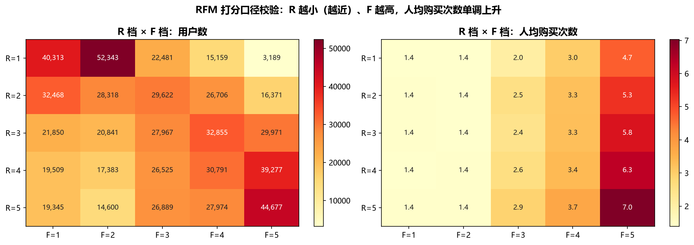
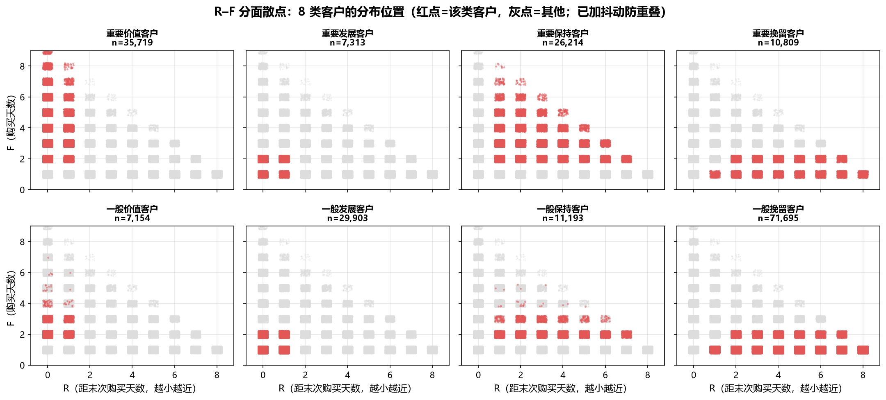
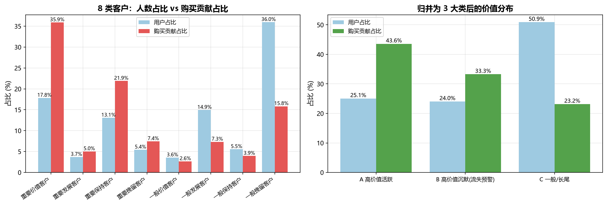

# 阶段 5 · RFM 用户价值分层结论

## 5.1–5.3 指标口径

| 指标 | 定义 | 说明 |
|---|---|---|
| R | 末次购买日距数据集末端（2017-12-03）的天数 | 全部落在 0–8 天 |
| F | **购买天数**（一个用户有多少天产生过购买） | 比"购买次数"抗单次多笔与刷单 |
| M | **购买的不同商品件数** | ⚠️ 数据集**没有金额字段**，M 是**代理指标**，不能等同于消费金额 |

**窗口局限（必须写在报告里）**：数据集只有 9 天，R 的取值范围被压缩到 0–8，
无法区分"沉默 1 个月的流失用户"和"沉默 1 周的老客"。真实业务中 R 的判别力需要至少 90 天窗口。

## 5.4 打分方式：qcut 五分位（替代均值 0/1）

- 方法：先 `rank(method='first')` 再 `qcut(…, 5)` 分五档。
  直接 qcut 会因为大量并列值（例如 F=1 的用户极多）导致分箱边界重复、档位不足，先 rank 可保证严格等分。
- R 越小越好 → 反向赋分；F / M 越大越好 → 正向赋分。
- 与原口径对比：均值 0/1 二分类最多只能区分 **8** 种组合，
  五分位方案可区分 **125** 种组合（5×5×5=125 理论上限），
  且均值切分会被极端值拉偏（F 的均值远高于中位数，导致"高价值"标签过度集中）。

## 5.5 分层结果（8 类客户模型）

分层规则：R_score / F_score / M_score ≥ 4 记为该维度"高"，组合成 8 类。

| 客户分层 | 用户数 | 人均购买次数 | 购买次数合计 | 人均购买天数 | 人均购买商品数 | 平均R | 用户占比 | 购买贡献占比 |
|---|---|---|---|---|---|---|---|---|
| 重要价值客户 | 118,999 | 6.014 | 715,611 | 3.637 | 5.71 | 0.2911 | 0.1783 | 0.3589 |
| 重要发展客户 | 24,524 | 4.093 | 100,371 | 1.78 | 3.934 | 0.4352 | 0.03674 | 0.05034 |
| 重要保持客户 | 87,238 | 5.005 | 436,614 | 3.021 | 4.774 | 2.789 | 0.1307 | 0.219 |
| 重要挽留客户 | 36,209 | 4.098 | 148,381 | 1.571 | 3.928 | 4.13 | 0.05425 | 0.07441 |
| 一般价值客户 | 23,720 | 2.226 | 52,789 | 2.163 | 2.023 | 0.289 | 0.03554 | 0.02647 |
| 一般发展客户 | 99,727 | 1.464 | 146,029 | 1.294 | 1.421 | 0.4314 | 0.1494 | 0.07323 |
| 一般保持客户 | 37,013 | 2.122 | 78,539 | 2.064 | 1.983 | 3.169 | 0.05546 | 0.03939 |
| 一般挽留客户 | 239,994 | 1.316 | 315,722 | 1.129 | 1.282 | 4.595 | 0.3596 | 0.1583 |

## 5.6 分层验证：少数人贡献多数购买

| 价值大类 | 用户数 | 购买次数合计 | 人均购买次数 | 用户占比 | 购买贡献占比 |
|---|---|---|---|---|---|
| A 高价值活跃 | 167,243 | 868,771 | 5.195 | 0.2506 | 0.4357 |
| B 高价值沉默(流失预警) | 160,460 | 663,534 | 4.135 | 0.2404 | 0.3328 |
| C 一般/长尾 | 339,721 | 461,751 | 1.359 | 0.509 | 0.2316 |

- 有购买行为的用户共 **667,424** 人。
- **重要价值客户** 人数占比 17.8%，却贡献了 **35.9%** 的购买次数，
  人均购买 6.0 次 —— 是全体购买用户的 2.0 倍。
- 高价值活跃 + 高价值沉默（A + B 类）合计人数占比 49.1%，
  贡献购买 76.8%。
- 一般/长尾（C 类）人数占比 50.9%，
  仅贡献 23.2%。
  → **运营资源绝不应按人数平均分配。**

## 5.8 分层运营动作

| 客户分层 | 用户数 | 人数占比 | 建议动作 |
|---|---|---|---|
| 重要价值客户 | 118,999 | 17.8% | VIP 专属客服 + 新品优先购 + 会员等级权益，目标：维持频次、提升客单 |
| 重要发展客户 | 24,524 | 3.7% | 购买频次不足但金额高，做「周期购/会员包」引导，目标：把一次性变常态 |
| 重要保持客户 | 87,238 | 13.1% | 沉默高价值，做「专属回归礼 + 老客价」触达，目标：唤醒复购 |
| 重要挽留客户 | 36,209 | 5.4% | 高价值但久未购买，人工外呼 + 大额回归券，最后一道挽留 |
| 一般价值客户 | 23,720 | 3.6% | 保持现有触达节奏，用满减凑单提升客单 |
| 一般发展客户 | 99,727 | 14.9% | 低价值新客，用首单/二单券培养习惯 |
| 一般保持客户 | 37,013 | 5.5% | 中低价值低频，全自动 Push 触达，控制成本 |
| 一般挽留客户 | 239,994 | 36.0% | 基本流失，仅做低成本召回（大促短信），不值得单独投放 |

## 5.9 一句话总结

把用户按 RFM 五分位切分后，"重要价值客户"以 17.8% 的人数贡献了 35.9% 的购买，
而"一般挽留客户"以 36.0% 的人数只贡献了 15.8% ——
分层有效，且直接给出了"把预算花在谁身上"的答案。
