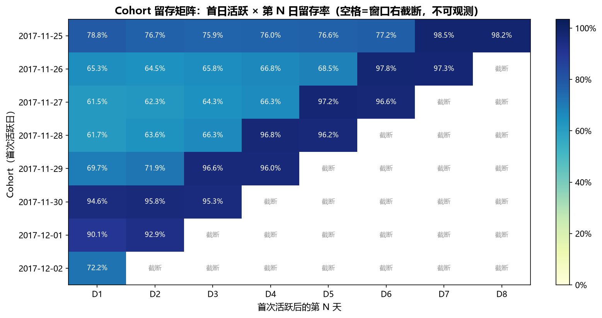
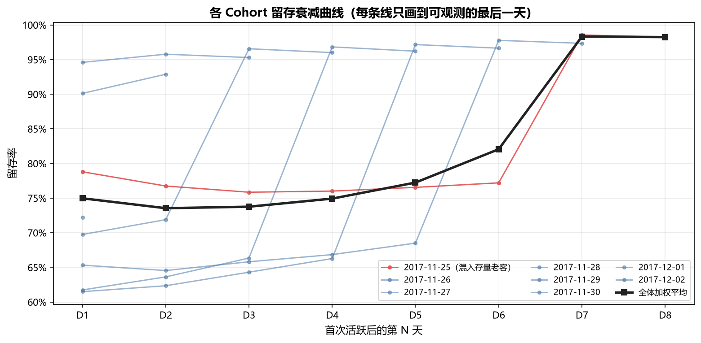
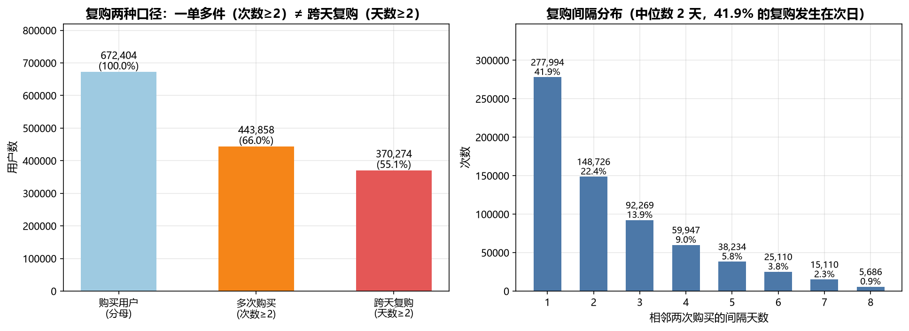
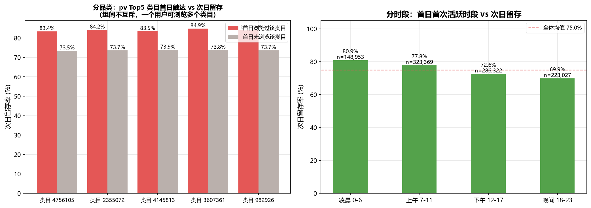

# 阶段 6 · 留存与复购结论

## 6.1 口径定义（先说清分母）

| 指标 | 定义 | 可观测性 |
|---|---|---|
| 次日留存率 | 首日活跃（cohort）用户中，第 2 天仍活跃的比例 | 11-25 ~ 12-02 共 8 个 cohort 可完整观测 |
| 7 日内回访率 | cohort 用户在第 1~7 天内任意一天回访的比例 | 仅前 2 个 cohort 完整，其余右截断 |
| 复购率 | 购买用户中**购买天数 ≥ 2** 的比例 | 9 天窗口全量可算，但低估真实复购 |

**窗口局限（必须写进报告）**：
1. 数据只有 9 天，只能看**短期留存**；真实业务的 30 日留存、月留存无法计算。
2. **2017-11-25 是窗口第一天**，当天"首次活跃"混入大量存量老客，
   其次日留存率 78.8% 显著高于后续 cohort 的 65.4% ——
   解读新增用户留存时应剔除该 cohort。
3. day-N 格子若 fd + N 超出 2017-12-03 则**不可观测**，矩阵中留空，不做任何填充或外推。

## 6.2–6.3 Cohort 留存

| day_n | 留存人数 | 分母 | 可观测cohort数 | 加权留存率 |
|---|---|---|---|---|
| 1 | 735,969 | 981,671 | 8 | 74.97% |
| 2 | 721,955 | 981,653 | 7 | 73.54% |
| 3 | 723,889 | 981,400 | 6 | 73.76% |
| 4 | 728,036 | 971,642 | 5 | 74.93% |
| 5 | 736,709 | 953,772 | 4 | 77.24% |
| 6 | 756,990 | 922,540 | 3 | 82.05% |
| 7 | 844,578 | 858,952 | 2 | 98.33% |
| 8 | 689,257 | 701,535 | 1 | 98.25% |

- 全体加权次日留存率 **75.0%**；剔除 11-25 存量混合 cohort 后为 **65.4%**。
- **日历效应（本阶段最重要的口径发现）**：几乎每个 cohort 在"第 N 天恰逢周末（12-02/12-03）"时
  留存率都跳到 95% 以上（如 11-30 cohort 的 D1 落在周五 12-01，留存 94.6%；
  11-26 cohort 的 D6 落在周六 12-02，留存 97.8%）。
  因此留存曲线的"翘尾"**不是用户粘性随时间变好，而是周末流量高峰的日历效应**；
  同理，加权 7 日留存（仅 2 个 cohort 可观测）高达 98.3%，也是被周末截断放大的，
  不能与常规意义上的 D7 留存直接比较。
- 剔除日历效应后看真实衰减：同一 cohort 在工作日区间（D1~D5）内基本平稳在 62%~72%，
  没有明显逐日衰减 —— 说明大促期间用户的回访意愿整体较强，流失主要集中在"首次活跃后的第二天"
  （次日留存 65.4% 意味着约四分之一新客第二天就流失了）。

## 6.4 复购

| 购买用户数 | 多次购买用户数 | 跨天复购用户数 | 人均购买次数 | 人均购买天数 | 复购用户人均购买次数 |
|---|---|---|---|---|---|
| 672,404 | 443,858 | 370,274 | 2.998 | 1.986 | 4.296 |

- 购买用户共 **672,404** 人；**多次购买（次数≥2）占 66.0%**，
  其中**跨天复购（天数≥2）占 55.1%** ——
  两者之差即"同一天内一单多件"的用户，约 73,584 人。
  用"购买天数"定义复购可以剔除这种一次性囤货行为，口径更稳。
- 复购用户人均购买 4.3 次，是全体购买用户（3.00 次）的
  1.4 倍。
- 相邻购买间隔中位数 **2 天**，41.9% 的复购发生在**次日** ——
  大促期间"连续下单"是复购的主要形态，复购召回的黄金窗口是首购后 24 小时。

## 6.5 分品类 / 分时段留存差异

| 类目ID | 首日浏览该类目用户数 | 该类目用户次日留存率 | 未浏览用户数 | 未浏览用户次日留存率 | 留存率差值 |
|---|---|---|---|---|---|
| 4,756,105 | 146,544 | 0.8345 | 835,127 | 0.7348 | 0.09964 |
| 2,355,072 | 122,531 | 0.8423 | 859,140 | 0.7365 | 0.1058 |
| 4,145,813 | 111,415 | 0.8349 | 870,256 | 0.7388 | 0.09614 |
| 3,607,361 | 104,997 | 0.8488 | 876,674 | 0.7378 | 0.111 |
| 982,926 | 120,831 | 0.8413 | 860,840 | 0.7369 | 0.1044 |

| 时段 | 新增用户数 | 次日留存率 |
|---|---|---|
| 凌晨 0-6 | 148,953 | 0.8091 |
| 上午 7-11 | 323,369 | 0.7781 |
| 下午 12-17 | 286,322 | 0.7264 |
| 晚间 18-23 | 223,027 | 0.6987 |

- 分品类：首日浏览**类目 3607361** 的新增用户次日留存率最高
  （84.9%，比未浏览用户高 11.1 个百分点），
  说明该类目对新客有更强的"钩子"效应，适合作为新客首屏推荐位。
- 分时段：**凌晨 0-6** 首次活跃的用户次日留存率最高（80.9%）。
  注意这是**自选择效应**而非时段的因果作用：凌晨还在逛的用户本来就是重度用户，粘性天然更高；
  晚间 18-23 点进入的新客留存最低（69.9%），
  高峰期流量虽大，但新客质量被稀释。
- 注意：品类分组不互斥（一个用户首日可浏览多个类目），结论方向性参考即可，不做因果推断。

## 6.6 一句话总结

新客留存的关键窗口是首次活跃后 48 小时；复购的一半发生在首购次日。
短期留存与复购都指向同一个动作：**首购/首访后 24 小时内的即时触达**
（优惠券到期提醒、同类商品推荐），比广撒网式召回更有效。
