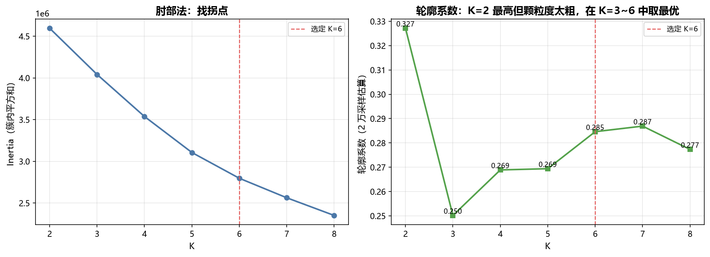
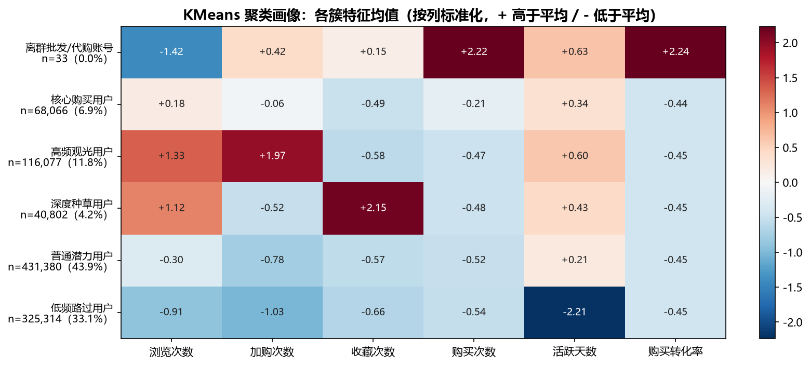
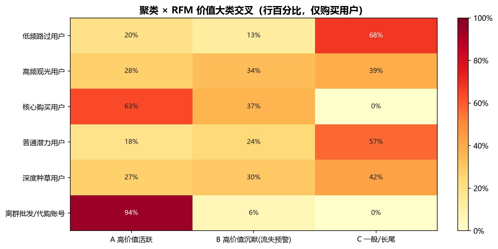

# 阶段 7 · 统计检验与用户聚类结论

## 7.1–7.3 假设检验

| 检验 | 组1 | 组2 | 组1转化数 | 组1样本量 | 组1转化率 | 组2转化数 | 组2样本量 | 组2转化率 | 率差(pp) | 相对提升 | z | p值 |
|---|---|---|---|---|---|---|---|---|---|---|---|---|
| 周末 vs 工作日（用户-日级主口径） | 周末 | 工作日 | 616,382 | 3,359,535 | 18.35% | 719,098 | 3,609,009 | 19.93% | -1.578 | -7.9% | -52.9 | <1e-300 |
| 周末 vs 工作日（用户级稳健性：仅周末活跃 vs 仅工作日活跃） | 仅周末活跃 | 仅工作日活跃 | 4,027 | 9,003 | 44.73% | 263 | 403 | 65.26% | -20.531 | -31.5% | -8.1 | 5.68e-16 |
| 高活跃 vs 低活跃（pv 中位数 66 切分） | 高活跃 | 低活跃 | 366,455 | 486,140 | 75.38% | 300,969 | 495,532 | 60.74% | +14.644 | +24.1% | +155.5 | <1e-300 |

**怎么读这些 p 值**：
- 三个检验的 p 值都远小于 0.05，差异在统计上**显著** —— 含义是"这么大（或更大）的差异在
  两组无差异的原假设下几乎不可能由随机噪声产生"，**而不是**"两个因素有因果关系"。
- 样本量到百万级后，**0.1 个百分点的率差也能显著**，所以必须同时看率差和相对提升：

**检验一 · 周末 vs 工作日**：周末转化率 18.35%，工作日 19.93%，
率差 -1.58pp（相对 -7.9%），**方向为负**。
结合阶段 3 的发现（周末 DAU 更高）可得完整结论：**周末流量更大，但转化质量反而略低** ——
周末的增量流量以"随便逛逛"的低意向用户为主。率差 1.6pp 属于"显著但不大"的效应，
不值得为周末单独加码投放，反而要在排期上注意周末流量的转化稀释。
用户级稳健性检验（仅周末活跃 44.7% vs 仅工作日活跃 65.3%，互斥独立）方向一致；
但该口径下"仅工作日活跃"的用户天然拥有更多可活跃天数（工作日 5 天 vs 周末 2 天），
购买机会更多，会**夸大**差异，因此效应量以用户-日口径的 -1.58pp 为准。

**检验二 · 高活跃 vs 低活跃**：购买率 75.4% vs 60.7%，
率差 +14.6pp（相对 +24.1%）—— 这才是真正有业务杠杆的差异：
**活跃度是转化最强的行为信号**，运营动作的优先级应围绕"提升活跃"而不是"追周末流量"。

## 7.4 KMeans 聚类

- 特征：pv / cart / fav / buy 频次 + 活跃天数 + 购买转化率（buy_cnt/pv），StandardScaler 标准化。
- 选 K：肘部法看拐点 + 轮廓系数（2 万采样估算）。K=2 的轮廓系数（0.327）最高，
  但只把用户切成"买/不买"两坨，业务颗粒度太粗；在 K=3~6 中取轮廓系数最高的 **K=6**
  （0.285）。

| cluster | 用户数 | 浏览次数 | 加购次数 | 收藏次数 | 购买次数 | 活跃天数 | 购买转化率 | 购买贡献占比 | 用户占比 | 画像命名 |
|---|---|---|---|---|---|---|---|---|---|---|
| 5 | 33 | 0.15 | 10.52 | 9.45 | 64.58 | 8.42 | 6457.58% | 0.1% | 0.0% | 离群批发/代购账号 |
| 2 | 68,066 | 117.86 | 7.88 | 2.77 | 8.72 | 8.08 | 24.42% | 29.8% | 6.9% | 核心购买用户 |
| 1 | 116,077 | 202.81 | 19.10 | 1.89 | 2.62 | 8.39 | 1.96% | 15.3% | 11.8% | 高频观光用户 |
| 4 | 40,802 | 186.90 | 5.34 | 30.20 | 2.46 | 8.19 | 3.70% | 5.0% | 4.2% | 深度种草用户 |
| 3 | 431,380 | 82.88 | 3.86 | 1.98 | 1.50 | 7.92 | 2.74% | 32.4% | 43.9% | 普通潜力用户 |
| 0 | 325,314 | 38.01 | 2.50 | 1.03 | 1.07 | 5.05 | 5.83% | 17.5% | 33.1% | 低频路过用户 |

- **核心购买用户**（68,066 人，占 6.9%）：人均购买 8.7 次、
  活跃 8.1 天，贡献全体 **29.8%** 的购买 ——
  与 RFM 的"少数用户贡献多数购买"结论互相印证。
- **深度种草用户**（40,802 人）：人均收藏 30.2 次、加购 5.3 次，
  但购买转化率仅 3.7% —— 典型的"种草未拔草"人群，
  是优惠券/限时提醒投放转化率最高的目标层。
- **离群簇**（33 人，占比 0.0034%）：人均购买 65 次却几乎零浏览，
  行为模式不像正常消费者，疑似批发/代购/脚本账号 ——
  KMeans 对极端值敏感会自然切出这类微簇；真实业务中这批账号应移交风控而非运营。

## 7.5 与 RFM 分层交叉验证

- 交叉表（仅购买用户，占全体 68.0%）：聚类结果与 RFM 价值大类的 **Cramér's V = 0.295**
  （0~1，越大关联越强）。
- 解读：两套方法切出的高价值人群高度重叠（核心购买用户簇中 A 类高价值活跃占比最高，
  低频路过簇则以 C 类长尾为主），说明分层结论**稳健、不依赖单一方法**；
  差异部分来自特征侧重不同 —— RFM 只看购买行为，KMeans 还纳入了浏览/加购/收藏过程行为，
  因此能识别出"还没买但深度种草"的潜力人群，这是 RFM 的盲区。

## 7.6 局限

1. **无金额字段**：聚类无法区分"买贵"和"买便宜"，高价值 ≠ 高消费额。
2. **9 天窗口**：活跃天数上限 9，无法识别月频/季频用户；转化率被大促周期抬高。
3. **特征右偏**：行为频次长尾严重，StandardScaler 不能消除偏态；极端用户对簇心影响大
   （表现为 33 人的离群微簇，已单独标注；主人群画像不受其影响）。
4. **轮廓系数为采样估算**：全量百万级计算过慢，用 2 万随机采样近似，多次采样波动 < 0.01。

## 7.7 一句话总结

统计检验发现**周末流量"量高质低"**（转化 -7.9%），真正的杠杆是活跃度
（高活跃用户购买率高 14.6pp）；KMeans 在无标签数据上独立切出了与 RFM 一致的
高价值人群（Cramér's V = 0.29），并额外定位了"深度种草未购买"的转化潜力层
与 33 个疑似批发/代购的离群账号 —— 前者交给运营做转化，后者交给风控。
